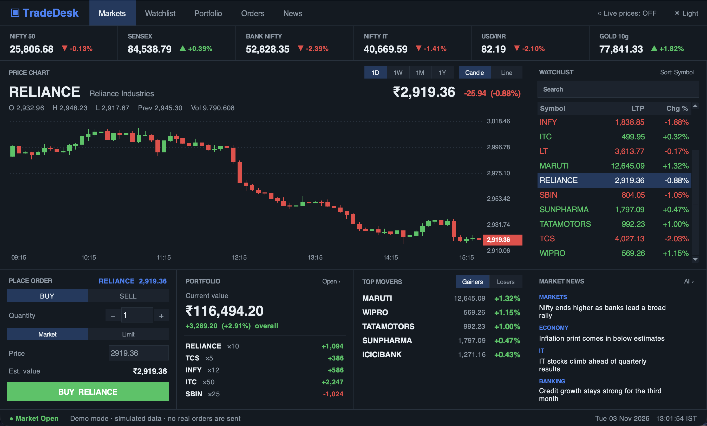
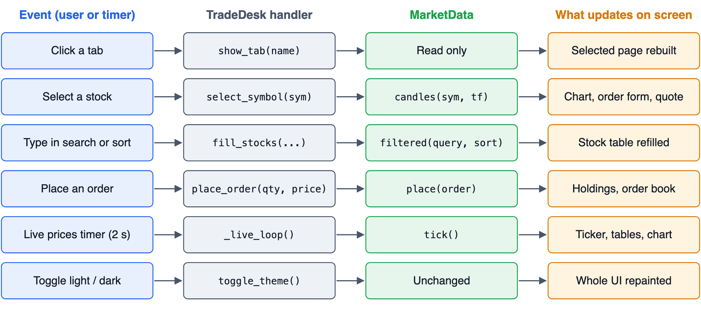

# TradeDesk

A mock NSE trading terminal built with Python and Tkinter, made for 21CSC203P Advanced Programming Practice (SRM KTR). It is a front end only: there is no backend, and all market data is simulated.



## Run

```bash
python3 tradedesk.py
```

It uses only the Python standard library (`tkinter`, `random`, `datetime`, `sys`), so there is nothing to install. On macOS, use a Python from python.org or uv: Apple's built-in Python ships an old Tk 8.5 that shows a blank window.

## Features

- Top bar with five tabs: Markets, Watchlist, Portfolio, Orders and News. It also has a dark/light toggle and a live-prices toggle.
- Index ticker strip: NIFTY 50, SENSEX, BANK NIFTY and others.
- Candle/line price chart drawn on a Tkinter Canvas, with 1D, 1W, 1M and 1Y timeframes.
- Watchlist you can search and sort.
- Buy/sell order form with Market and Limit orders and a confirmation dialog.
- Portfolio with P&L and allocation, an order book where open orders can be cancelled, and news cards.

## Layout

The window has four stacked bands: top bar, ticker strip, content and status bar. In the style of the Bing homepage, panels fill a connected grid, with thin lines instead of empty space between them. They stretch when the window is resized.

```text
+----------------------------------------------------------------+
| TradeDesk | Markets | Watchlist | Portfolio | Orders | News     |
+----------------------------------------------------------------+
| NIFTY 50 | SENSEX | BANK NIFTY | NIFTY IT | USD/INR | GOLD 10g  |
+-----------------------------------------------+----------------+
| Price chart                                   | Watchlist      |
+---------------+---------------+---------------+----------------+
| Place order   | Portfolio     | Top movers    | Market news    |
+---------------+---------------+---------------+----------------+
| Market status | Demo mode                               | Clock |
+----------------------------------------------------------------+
```

## How it works

Each user or timer event goes to a handler in the `TradeDesk` class, which uses `MarketData` and then updates the screen.



## Paradigms used

- **Object-oriented:** the `Stock`, `MarketData`, `FlatButton` and `TradeDesk` classes.
- **Event-driven:** callbacks, variable traces and `after()` timers.
- **Functional:** `filter`, `sorted`, `map` and `lambda`.
- **Procedural:** formatting helpers.
- **State machine:** tab navigation.
